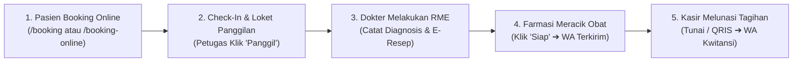

# 🏥 DAFTAR AKUN DEMO & PANDUAN PENGUJIAN SIMRS RS AISYAH MEDIKA

Dokumen ini berisi daftar lengkap akun demo untuk semua peran (*role*), kredensial login, hak akses modul, serta panduan skenario simulasi operasional rumah sakit dari pendaftaran hingga kasir dan notifikasi WhatsApp.

---

## 🔑 1. Kredensial Login Akun Demo

> **Kata Sandi Global:** Semua akun staf dan pasien di bawah ini menggunakan kata sandi: `password`

| No | Peran / Hak Akses | Nama Pengguna | Alamat Email | Kata Sandi | URL Akses |
|:--:|:---|:---|:---|:---:|:---|
| **1** | **Super Admin** | Super Administrator | `superadmin@aisyahmedika.id` | `password` | `/admin` |
| **2** | **Dokter Spesialis** | dr. Siti Aisyah, Sp.PD | `dokter@aisyahmedika.id` | `password` | `/admin` |
| **3** | **Perawat / Triase** | Ns. Rahmat Hidayat, S.Kep | `perawat@aisyahmedika.id` | `password` | `/admin` |
| **4** | **Petugas Admisi** | Dina Admisi | `admisi@aisyahmedika.id` | `password` | `/admin` |
| **5** | **Apoteker / Farmasi** | apt. Farhan Pratama, S.Farm | `farmasi@aisyahmedika.id` | `password` | `/admin` |
| **6** | **Kasir Keuangan** | Kurnia Kasir | `kasir@aisyahmedika.id` | `password` | `/admin` |
| **7** | **Pasien Terdaftar** | Budi Santoso | `pasien@aisyahmedika.id` | `password` | `/login` (Portal Pasien) |

---

## 📱 2. Data Pasien Demo & Integrasi WhatsApp Real

Untuk menguji fitur notifikasi WhatsApp, akun pasien demo telah dihubungkan langsung dengan nomor WhatsApp aktif yang Anda konfigurasikan:

* **Nama Pasien Utama:** Budi Santoso (No. RM: `RM-202611-0001`)
* **Nomor WhatsApp:** `085608543495`
* **NIK Pasien:** `3201011234560001`
* **Golongan Darah / Alergi:** Golongan O / Penisilin, Seafood
* **Anggota Keluarga Terhubung:**
  1. **Anak:** Siti Rahmawati (No. RM: `RM-202611-0002`, 6 tahun)
  2. **Istri:** Ratna Dewi (No. RM: `RM-202611-0003`, 32 tahun)

> [!TIP]
> Setiap kali ada aksi pendaftaran, panggilan antrean di loket, obat siap di farmasi, atau pelunasan tagihan kasir, pesan WhatsApp akan otomatis terkirim langsung ke nomor **085608543495** melalui Fonnte Gateway.

---

## 🧭 3. Hak Akses Modul per Peran

### 1. Super Admin (`superadmin@aisyahmedika.id`)
* **Akses Penuh Seluruh Modul:**
  * Direktori Pasien & Cetak Kartu Berobat Digital (Standar CR80 ID Card).
  * Rekam Medis Elektronik (RME / CPPT).
  * Manajemen Poliklinik & Jadwal Praktik Dokter.
  * Loket Panggilan Antrean & Admission.
  * Instalasi Farmasi (Resep & Stok Obat).
  * Kasir & Penagihan (Billing Invoices).
  * Manajemen Tempat Tidur (Bed Management VVIP, VIP, Kelas 1-3, ICU).
  * Audit Log Keamanan & Pengaturan RS.

### 2. Dokter Spesialis (`dokter@aisyahmedika.id`)
* **Menu Pelayanan Medis:**
  * Rekam Medis Elektronik (Pencatatan SOAP: Subjektif, Objektif/TTV, Asesmen ICD-10, Planning).
  * Tindakan Medis (ICD-9-CM).
  * E-Prescribing (Resep Obat Elektronik langsung terhubung ke Instalasi Farmasi).
  * Loket Panggilan Ruang Praktik Poliklinik.

### 3. Perawat / Nurse (`perawat@aisyahmedika.id`)
* **Menu Keperawatan:**
  * Loket Panggilan Antrean Poliklinik (Tombol Panggil, Mulai Melayani, Selesai).
  * Pengkajian Tanda-Tanda Vital Awal (Tensi Darah, Nadi, Suhu, Respirasi).

### 4. Petugas Admisi (`admisi@aisyahmedika.id`)
* **Menu Loket & Pendaftaran:**
  * Loket Panggilan & Admission.
  * Pendaftaran Pasien Langsung di Loket (Walk-in Registration).
  * Informasi Ketersediaan Kamar Rawat Inap Real-time.

### 5. Apoteker / Farmasi (`farmasi@aisyahmedika.id`)
* **Menu Instalasi Farmasi:**
  * Pemrosesan Resep Obat (Pending ➔ Preparing ➔ Ready ➔ Handed Over).
  * Tombol **"Siap"**: Mengubah status racikan menjadi *Ready* & memicu WhatsApp otomatis ke pasien.
  * Tombol **"Serahkan Obat"**: Mengurangi stok obat di database secara otomatis & mencetak etiket aturan pakai.
  * Monitoring Stok Obat & Peringatan Kadaluarsa.

### 6. Kasir / Billing (`kasir@aisyahmedika.id`)
* **Menu Penagihan & Kasir:**
  * Tagihan & Invoice Kunjungan Pasien.
  * Pembayaran Tunai (Kalkulasi otomatis uang diterima dan kembalian).
  * Pembayaran Digital QRIS Dinamis & Virtual Account.
  * Cetak Struk Kwitansi Termal Kasir & Pelunasan Resmi.

### 7. Pasien (`pasien@aisyahmedika.id`)
* **Portal Pasien Mandiri (`/akun/dashboard`):**
  * Ringkasan Antrean Aktif Hari Ini & E-Tiket QR Check-in.
  * Booking Antrean Dokter Spesialis (Pilih poli, dokter, dan jadwal).
  * Manajemen Profil Anggota Keluarga (Daftar berobat untuk anak/istri).
  * Riwayat Rekam Medis & Riwayat Kunjungan.
  * Rincian Tagihan & Pelunasan Mandiri via QRIS.
  * Cetak Kartu Berobat Digital Pasien.

---

## 🎬 4. Skenario Simulasi Uji Coba End-to-End

Anda dapat menjalankan skenario operasional lengkap rumah sakit berikut:



1. **Skenario Antrean Masuk:** Login sebagai `admisi@aisyahmedika.id` atau `perawat@aisyahmedika.id`, buka menu **Loket Panggilan Antrean**. Klik tombol **Panggil** pada nomor antrean Budi Santoso (`DAL-...-001`). Pasien akan menerima WhatsApp panggilan ke ruang dokter.
2. **Skenario Farmasi:** Login sebagai `farmasi@aisyahmedika.id`, buka menu **Resep Obat**. Cari resep Siti Rahmawati (`VIS-DEMO-003`). Klik tombol **Siap**. Sistem mengirim WhatsApp bahwa obat sudah selesai diracik.
3. **Skenario Kasir:** Login sebagai `kasir@aisyahmedika.id`, buka menu **Tagihan / Invoices**. Buka tagihan `INV-...-0001` (Budi Santoso). Klik **Bayar Tunai** atau **QRIS / VA**. Sistem menandai lunas dan mengirimkan bukti pembayaran via WhatsApp.

---

## 🛠️ 5. Perintah Artisan Database Seeder & Factory

### Menjalankan Seeder
Untuk mereset atau mengisi ulang database dengan data master & transaksi demo:
```bash
# Menjalankan seeder lengkap (Master + Akun Demo + Transaksi Demo)
php artisan db:seed

# Atau refresh database dari awal beserta seeder
php artisan migrate:fresh --seed
```

### Menggunakan Factory di Kode / Test (Pest & Unit Testing)
Semua model SIMRS kini telah dilengkapi factory lengkap:
```php
// User & Role
$user = User::factory()->create();

// Pasien & Rekam Medis
$patient = Patient::factory()->create();
$medicalRecord = MedicalRecord::factory()->create();

// Dokter & Jadwal
$doctor = Doctor::factory()->create();
$schedule = DoctorSchedule::factory()->create();

// Kamar & Bed
$room = Room::factory()->create();
$bed = Bed::factory()->create(['room_id' => $room->id]);

// Obat & Resep
$medicine = Medicine::factory()->create(['stock' => 100]);
$prescription = Prescription::factory()->create();
$prescriptionItem = PrescriptionItem::factory()->create();

// Tagihan & Pembayaran
$invoice = Invoice::factory()->create();
$invoiceItem = InvoiceItemFactory::new()->create();
$payment = Payment::factory()->create();

// Verifikasi OTP
$otp = OtpVerification::factory()->create();
```
